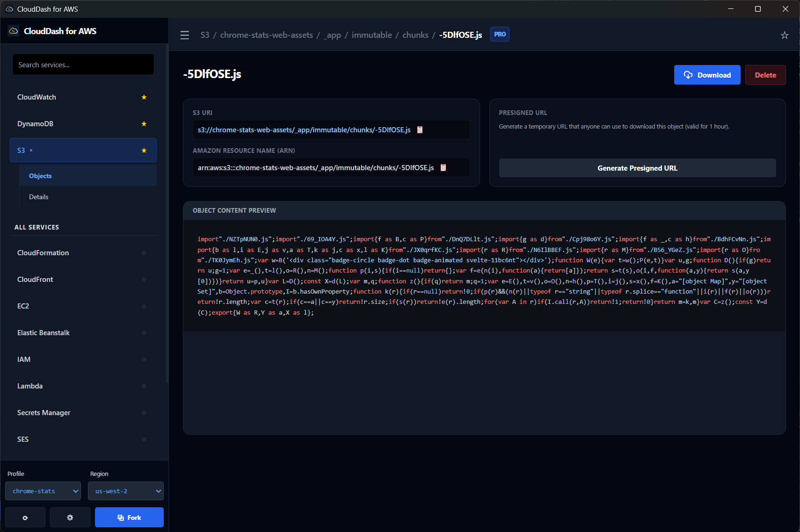
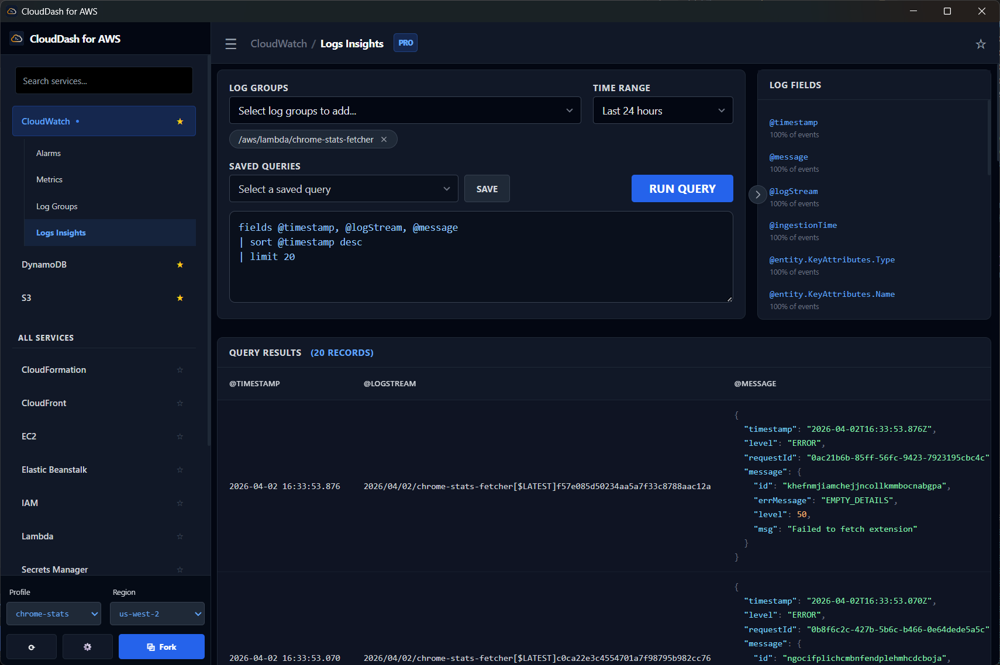
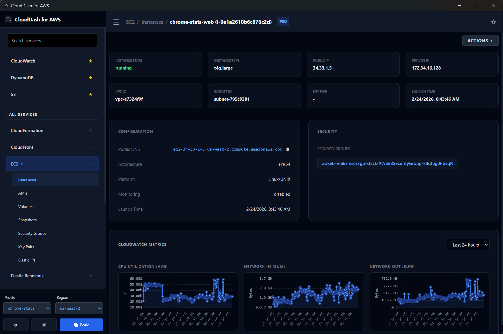

# CloudDash for AWS

CloudDash for AWS is a local-first AWS management dashboard built with Tauri, SvelteKit, TypeScript, and Rust. It is designed for developers and operators who want a fast native interface for day-to-day AWS work without moving their cloud credentials, profiles, or operational data into a hosted team service.

This repository contains the CloudDash app source code, including the desktop shell, frontend UI, Tauri commands, AWS service integrations, and release automation. Find official downloads on the [CloudDash website](https://clouddash.dev/download). The macOS app is distributed through the [Mac App Store](https://apps.apple.com/us/app/clouddash-for-aws/id6837349494?mt=12&platform=mac).

Official Website: [clouddash.dev](https://clouddash.dev/)

DISCLAIMER: CloudDash is not affiliated with Amazon Web Services.

## Screenshots

## Project Goals

- Keep AWS profiles and user data local.
- Provide native builds for Windows, Linux, macOS, Android, iPhone, and iPad.
- Make the source available so users can inspect, build, and contribute to the app.

## Mac App Store package

The [Mac App Store workflow](.github/workflows/mac-app-store.yml) builds a universal Apple Silicon and Intel app, verifies its signature, and produces a signed `CloudDash-for-AWS.pkg`. Set these secrets in the GitHub `mac-app-store` environment before running it:

| Secret | Value |
| --- | --- |
| `MAC_APP_STORE_APP_CERTIFICATE` | Base64-encoded `.p12` export of the Apple Distribution or Mac App Distribution certificate and its private key. |
| `MAC_APP_STORE_APP_CERTIFICATE_PASSWORD` | Password for that `.p12` export. |
| `MAC_APP_STORE_INSTALLER_CERTIFICATE` | Base64-encoded `.p12` export of the Mac Installer Distribution certificate and its private key. |
| `MAC_APP_STORE_INSTALLER_CERTIFICATE_PASSWORD` | Password for that `.p12` export. |
| `MAC_APP_STORE_PROVISIONING_PROFILE` | Base64-encoded Mac App Store Connect provisioning profile for `dev.clouddash.aws`, created with the same app distribution certificate. |

Run **Actions → Mac App Store → Run workflow** and download the `clouddash-mac-app-store` artifact. Upload the `.pkg` using Transporter on a Mac. The package uses the marketing version from [the Tauri configuration](src-tauri/tauri.conf.json) and a build number based on the workflow run and attempt. Set the App Store Connect macOS version to the matching marketing version before attaching the processed build.

### Upload to App Store Connect from GitHub Actions

Create an App Store Connect team API key with the **Developer** role. Add the issuer UUID as `MAC_APP_STORE_API_ISSUER_ID`, the key ID as `MAC_APP_STORE_API_KEY_ID`, and the contents of the downloaded `.p8` as `MAC_APP_STORE_API_PRIVATE_KEY` in the `mac-app-store` environment.

From **Actions → Upload to App Store Connect**, run [the upload workflow](.github/workflows/mac-app-store-upload.yml) on `main`. Enter the numeric run ID from the successful Mac App Store build URL. The workflow verifies and uploads that build’s signed installer. After Apple processes it, select the build on the macOS draft in App Store Connect.

See the [Apple app record guide](https://developer.apple.com/help/app-store-connect/create-an-app-record/add-a-new-app/) and [Tauri App Store guide](https://v2.tauri.app/distribute/app-store/).

## Sponsorship

CloudDash development is sponsored by [Chrome-Stats](https://chrome-stats.com/), a platform for researching Chrome extensions, browser ecosystem data, and extension market trends.

If CloudDash is useful to you or your company, please consider sponsoring the project. Sponsorship helps pay for code signing, release infrastructure, CI builds, test devices, security maintenance, and the time required to keep CloudDash improving.

You can support the project by using the GitHub Sponsors button available on this repository, sharing feedback, reporting issues, and contributing patches.

## License

This repository is licensed under the Functional Source License, Version 1.1, ALv2 Future License (`FSL-1.1-ALv2`). Current releases are Fair Source / source-available, not OSI-approved open source.

Each version becomes available under Apache License 2.0 on the second anniversary of the date that version was made available. See [LICENSE.md](LICENSE.md) and [NOTICE.md](NOTICE.md).

CloudDash trademarks, logos, signing keys, official builds, update endpoints, and distribution infrastructure are not granted under the software license.
